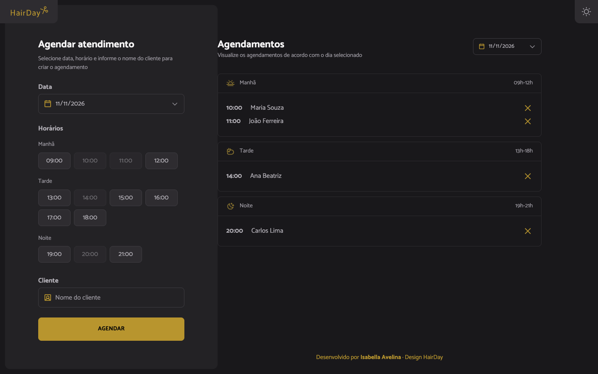
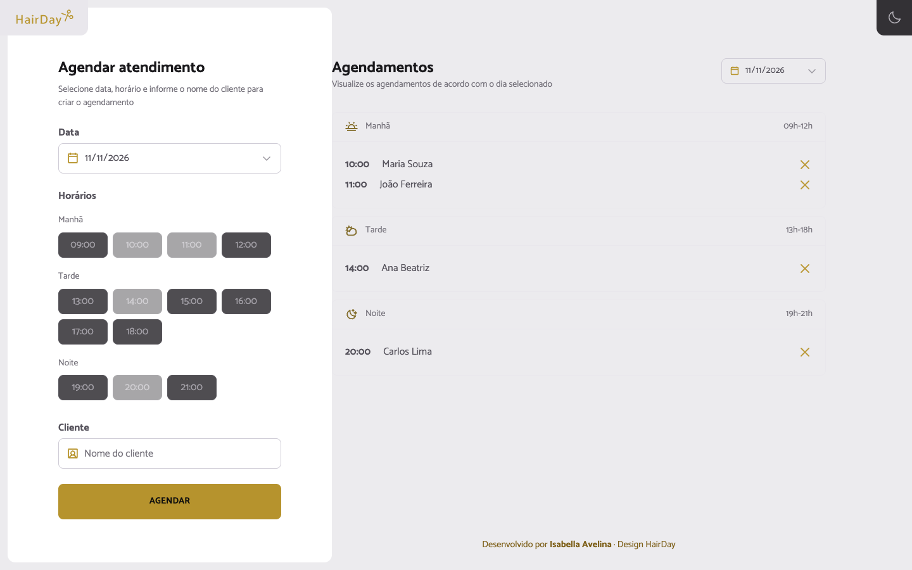
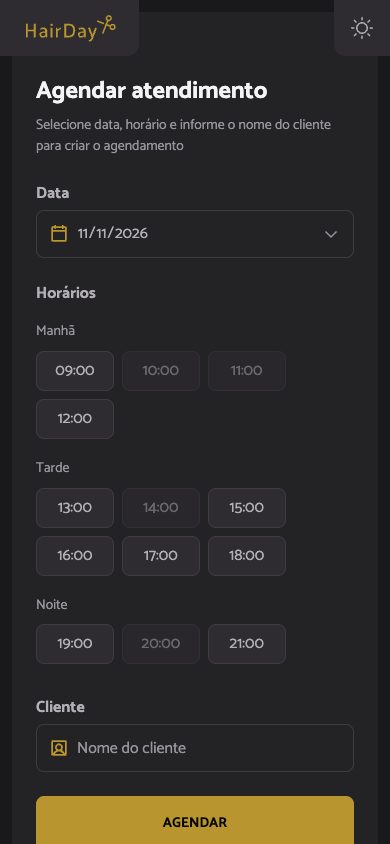
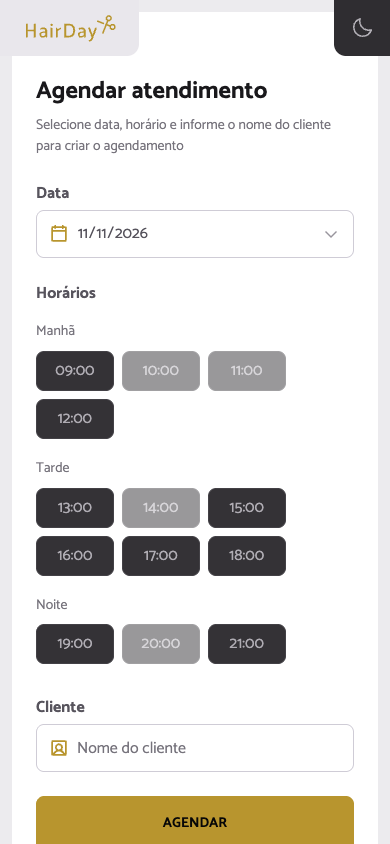

# HairDay

Plataforma de agendamento para salão de beleza — SPA em **React + TypeScript** que permite cadastrar agendamentos (cliente, data e horário), visualizá-los agrupados por período (**Manhã, Tarde e Noite**), filtrar por dia e excluir pelo botão de lixeira.

| | Dark (padrão do design) | Light |
|---|---|---|
| Desktop |  |  |
| Mobile |  |  |

## Funcionalidades

- **Criar agendamentos** pelo formulário (nome do cliente, data e horário), com validação dos três campos.
- **Grade de horários de funcionamento** (09h–21h): horários já agendados ou já passados (no dia atual) ficam desabilitados.
- **Agenda agrupada por período** — Manhã (09h–12h), Tarde (13h–18h) e Noite (19h–21h) — com mensagem de estado vazio por período.
- **Filtro por data** sincronizado com o formulário: uma única fonte de verdade (`selectedDate`) no Context.
- **Excluir agendamentos** pela lixeira, com atualização imediata da interface e do formulário.
- **Alternância de tema claro/escuro** com botão no canto superior direito (espelhando o box do logo) e persistência no `localStorage` (`hairday:theme`).
- **Responsivo**: duas colunas no desktop (≥1100px) e empilhado no mobile.

## Tecnologias

- [React](https://react.dev) 19 — componentes funcionais + hooks
- [TypeScript](https://www.typescriptlang.org)
- [Vite](https://vite.dev)
- [Tailwind CSS](https://tailwindcss.com) v4
- [Playwright](https://playwright.dev) — testes E2E e capturas de tela (usa o Chrome instalado no sistema)

## Como executar

```bash
npm install     # instalar dependências
npm run dev     # servidor de desenvolvimento
npm run build   # build de produção (tsc + vite)
npm run lint    # lint (oxlint)
```

### Testes e capturas de tela (Playwright)

Com o dev server rodando (o script usa `http://localhost:5199/` por padrão; ajuste com a variável `URL=`):

```bash
npm run test:e2e     # fluxo completo: cadastro, exibição, exclusão, filtro e console
npm run screenshots  # gera screenshots/{desktop,mobile,desktop-light,mobile-light}.png
```

Os scripts usam o Chrome instalado no sistema (`channel: "chrome"`), sem baixar browsers.

## Estrutura de pastas

```text
src/
├── assets/            # SVGs originais do design (logo, calendário, períodos, lixeira…)
├── components/        # Sidebar, AppointmentForm, AppointmentCard,
│                      # AppointmentsList, PeriodFilter, EmptyState, ThemeToggle
├── context/           # AppointmentsContext.tsx (Provider + hook useAppointments)
├── data/              # openingHours.ts (grade 09h–21h) e initialAppointments.ts
├── hooks/             # useTheme.ts (tema claro/escuro)
├── types/             # types.ts (Appointment, Period, AppointmentFormValues)
├── utils.ts           # todayISO, nowHHMM, getPeriodFromTime
├── App.tsx
├── index.css          # Tailwind + design tokens (dark + light)
└── main.tsx

scripts/               # screenshot.mjs e e2e.mjs (Playwright)
screenshots/           # desktop/mobile × dark/light
docs/evidencias/       # log de execução dos testes
```

## Conceitos de React praticados

- **`useState`** — estado dos agendamentos (no Context) e dos campos do formulário.
- **Context API** — `AppointmentsProvider` + hook `useAppointments` como fonte única de verdade.
- **Props e tipos TypeScript** — `Appointment`, `Period`, `AppointmentFormValues` e Props de componentes.
- **`map()`** para renderizar listas, **`filter()`** para o dia selecionado e **`reduce()`** para agrupar por período.
- **Formulário controlado** com validação e mensagem de erro.

## Design

Reprodução do design "Plataforma de agendamento" (comunidade): tema dark `#19181b` com destaque dourado `#b8952e`, fonte [Catamaran](https://fonts.google.com/specimen/Catamaran) e ícones originais em `src/assets/`. Os tokens de cores estão em `src/index.css` e documentados no [AGENTS.md](AGENTS.md).

A pedido do usuário, foi adicionado um **tema claro** (com a escala de luminosidade invertida e o dourado aprofundado para manter o contraste) e um botão de alternância com persistência no `localStorage` (`hairday:theme`). O design original do Figma é somente dark; o tema claro é uma extensão fiel da mesma paleta.

Os agendamentos iniciais em `src/data/initialAppointments.ts` são **dados provisórios de demonstração** (marcados no código), prontos para serem substituídos por dados reais.

## Evidências das ferramentas (board)

- **Playwright** ✅ — o Playwright MCP não estava configurado na sessão de desenvolvimento, então o Playwright foi usado **como biblioteca** em scripts reproduzíveis: `scripts/e2e.mjs` valida o fluxo completo (todos os testes passam — log em `docs/evidencias/playwright-e2e.txt`) e `scripts/screenshot.mjs` gera as capturas desktop/mobile em ambos os temas com 0 erros de console.
- **Context7** ⚠️ — o Context7 MCP não estava disponível na sessão de desenvolvimento (nenhum servidor MCP configurado). Como alternativa, a sintaxe foi verificada com `tsc -b` (checagem de tipos no build) e a implementação seguiu as versões instaladas. Limitação registrada no relatório de entrega.
